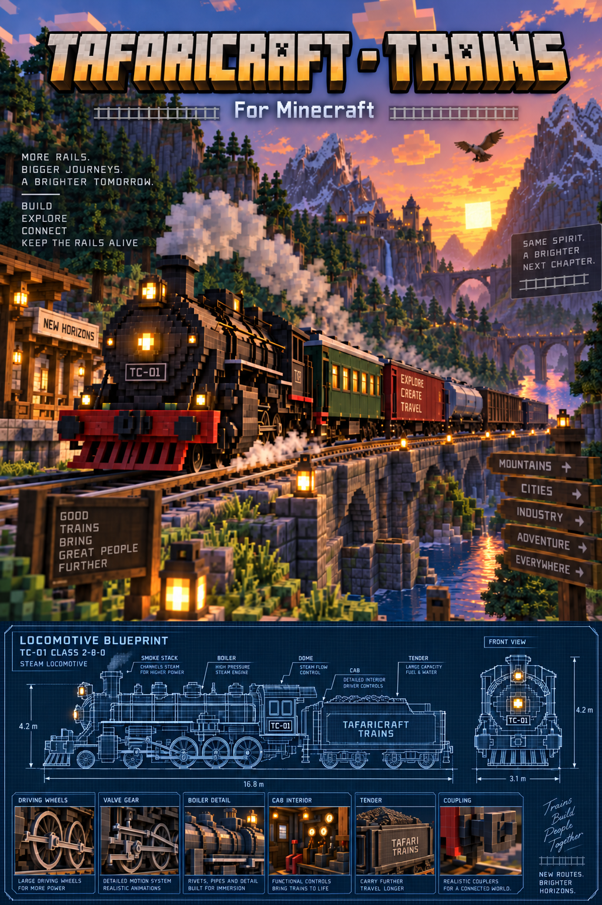

<div align="center">



# 🚂 TafariCraft - Trains

### A modern Minecraft 1.20.1 continuation of the classic Traincraft experience.

**Minecraft 1.20.1 • Forge 47.3.22 • Java 17**

🚂 Steam • 🛢️ Diesel • ⚡ Electric • 🚃 Rolling Stock • 🛤️ Expanded Track System • 🔗 Consists

</div>

---

## About

**TafariCraft - Trains** is an unofficial modernization and port of the classic **Traincraft** mod for **Minecraft 1.20.1 Forge**.

The project preserves the character of Traincraft while rebuilding its locomotives, rolling stock, track system, controls, physics, GUIs, effects, and supporting gameplay systems for a modern Forge environment.

This is not a compatibility wrapper around an old JAR. The current project contains extensive rewrites, fixes, recovered/restored content, new track tooling, new locomotive systems, and large-scale runtime validation.

---

## Current Development State

**Status: Final development / release-candidate validation** !!!About too Release Stable Build!!! Get ready its about to be reborn!

The core train and track systems are now substantially implemented. Current work is focused on final runtime regression testing, polish, compatibility, documentation, and release preparation.

The source repository is active development. A public release build has not yet been published.

---

## Major Features

### 🚂 Locomotives
- Steam, diesel, and electric locomotive support
- Forward and reverse operation
- Track-aware movement
- Hill and grade handling
- Mass-aware acceleration and traction
- Functional braking and handbrake controls
- Classic-inspired HUDs and GUIs
- Locomotive-specific effects, sounds, and controls

### 🔥 Steam Systems
- Real boiler temperature
- Coal and water consumption
- Tender-to-locomotive coal and water supply
- Automatic water handling
- Boiler overheating warnings
- Steam venting and failure behavior
- Emergency cooling behavior
- Boiler explosion/failure handling
- Inventory recovery rules

### ⚡ Electric Rail Operation
- Functional electric locomotives
- **Energy Track** support
- Redstone-powered connected Energy Track runs
- Line-power behavior for electric locomotives
- Energy Track visuals designed to retain the normal track look while showing energized effects when active

### 🚃 Rolling Stock
- Steam tenders
- Freight cars
- Passenger coaches
- Cabooses
- Additional restored rolling stock
- Passenger seating
- Multi-car train operation
- Model-aware spacing and coupling

### 🔗 Coupling & Consists
- Dual-ended coupling support
- Locomotive-to-tender operation
- Multi-car consists
- Stable forward and reverse operation
- Curve, hill, and transition handling
- Consist spacing control
- Cleanup when linked rolling stock is removed

A five-car validation consist has been used extensively during development:

**Small Steam → Tender → Freight → Passenger Coach → Caboose**

### 🛤️ Track System
The restored/expanded railway system includes:
- Normal, medium, long, and very-long straights
- Medium and large curve families
- 29x / 32x curve families
- 45-degree curve families
- Left/right switches
- Parallel switches and curves
- Crossings and diamond crossings
- Diagonal track families
- Straight slopes
- Curved slopes
- Station and special-purpose tracks
- Energy Track variants
- Direction-aware placement
- Connector-aware snapping
- White real-track placement previews

Track geometry and train ride/path behavior are treated as protected systems during final cleanup to avoid regressions in movement, slopes, curves, and reverse consist handling.

### 🧰 Tracks Builder & Blueprints
- Tracks Builder gameplay tool
- Track material handling
- Blueprint route planning
- Blueprint-saved track direction/hand data
- Support for complex track families
- Builder-assisted automatic placement
- Placement compatibility checks
- Runtime and headless validation tooling

The Builder/Blueprint system is one of the areas receiving final runtime regression testing before release.

### 🎛️ Classic Traincraft Feel
Where practical, TafariCraft - Trains preserves the classic Traincraft presentation:
- Classic-style locomotive HUD
- Classic-inspired locomotive and tender GUIs
- Familiar fuel/water gameplay
- Restored legacy models and textures
- Modernized behavior without intentionally discarding the original mod's identity

---

## Requirements

| Component | Version |
|---|---|
| Minecraft | **1.20.1** |
| Mod Loader | **Forge** |
| Forge | **47.3.22** |
| Java | **17** |
| Project Status | **Final development / runtime validation** |

---

## Building From Source

Clone the repository and build with the included Gradle wrapper using **Java 17**.

Windows PowerShell:

```powershell
.\gradlew.bat clean build
```

Development client:

```powershell
.\gradlew.bat runClient
```

See [DEVELOPMENT_README.md](DEVELOPMENT_README.md) for project-specific development notes.

---

## Installation

When an approved public build is available:

1. Install **Minecraft 1.20.1**.
2. Install **Forge 47.3.22**.
3. Place the TafariCraft - Trains JAR in the Minecraft `mods` folder.
4. Launch Minecraft with the Forge profile.

Release binaries will be published only through approved project release pages and subject to the licensing/permission requirements described in this repository.

---

## Credits

TafariCraft - Trains exists because of the work of the original **Traincraft** creators, developers, artists, maintainers, and community contributors.

### Original Creators
- **Spitfire4466** — Original founder and creator of the Train and Zeppelin Mod / Traincraft
- **Mrbrutal / Mr. Brutal** — Co-creator, developer, and longtime maintainer

### Original Artwork & Models
- **DAYdiecast**
- **Ontax**
- **Skspajdalfsks**

### Additional Original Development
- **Naiten** — Turning-mechanics assistance
- **EternalBlueFlame** and other contributors — 1.7.10 port and later development

### TafariCraft - Trains
- **RRyanward** — Current TafariCraft - Trains modernization / Minecraft 1.20.1 port maintainer

Full attribution is maintained in [CREDITS.md](CREDITS.md).

---

## License & Attribution

**TafariCraft - Trains is an unofficial derivative and modernization of Traincraft.**

Legacy Traincraft material remains subject to its applicable original licensing and attribution requirements. This repository also contains substantial new code, rewrites, compatibility work, fixes, and systems developed for the 1.20.1 port.

Read:
- [LICENSE.md](LICENSE.md)
- [NOTICE.md](NOTICE.md)
- [CREDITS.md](CREDITS.md)

Original Traincraft repositories:
- https://github.com/Traincraft/Traincraft
- https://github.com/EternalBlueFlame/Traincraft-5
- https://github.com/Spitfire4466/Traincraft-5

TafariCraft - Trains is **not an official Traincraft release** and does not claim endorsement by the original Traincraft authors.

---

## Project Links

- **GitHub:** https://github.com/RRyanward/TafariCraft-Trains
- **Issues / Bug Reports:** GitHub Issues
- **CurseForge:** Planned public release page
- **Documentation / In-game Guide:** In active development

---

<div align="center">

### 🚂 TafariCraft - Trains

**Build • Explore • Connect**

**Keep the rails alive.**

</div>
